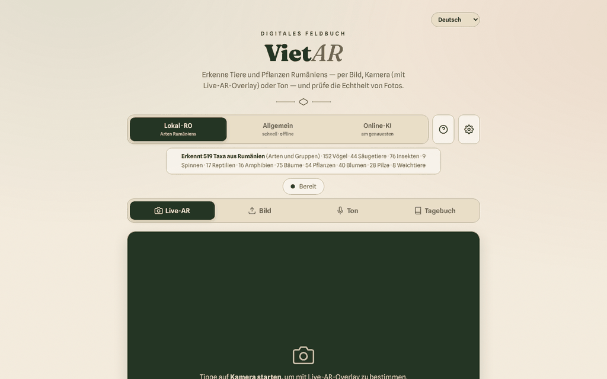

# VietAR — Fauna und Flora Rumäniens

[English](README.md) · [Română](README.ro.md) · [Français](README.fr.md) · [Italiano](README.it.md) · [Español](README.es.md) · [Português](README.pt.md) · **Deutsch** · [Magyar](README.hu.md)

**Version:** 19.2.5 · **Zuletzt aktualisiert:** 2026-10-23

Oberflächensprachen: **Română, English, Français, Italiano, Español, Português (PT), Deutsch, Magyar**

**Online / Demo:** https://chiuta.github.io/VietAR/

PWA in einer einzigen `index.html` (+ `vendor/`, `sw.js`, `manifest.webmanifest`): Sie erkennt Tiere und Pflanzen anhand eines Fotos, der Kamera („AR“-Überlagerung) oder eines Geräuschs, prüft orientierend die C2PA-Herkunftshinweise von Bildern und führt ein lokales Feldtagebuch (filterbar und druckbar). Die lokale Engine (CLIP, 519 rumänische Taxa) läuft im Browser; optional gibt es einen Modus „Online-KI“.

**Achtung: Die automatische Bestimmung kann falsch sein. Verzehren Sie Pflanzen oder Pilze nicht auf Grundlage dieser Anwendung; manche Arten sind giftig oder tödlich.** Die Ergebnisse sind orientierend, keine wissenschaftlichen Bestimmungen.

## Verwendung
Öffnen Sie die veröffentlichte Seite (GitHub Pages) oder stellen Sie den Ordner mit einem statischen HTTP-Server bereit (zum Beispiel `python3 -m http.server`). Über `file://` blockiert der Browser ES-Module: Oberfläche, Tagebuch und Export bleiben nutzbar, und die Anwendung zeigt eine klare Meldung, dass die Bestimmung nicht starten kann (statt eines Fehlers in der Konsole). Wählen Sie die Engine (Lokal·RO, Allgemein, Online-KI) und dann: „Live-AR“ (Kamera), „Bild“, „Ton“ oder „Tagebuch“.

## Was NICHT offline funktioniert / welche Daten den Browser verlassen
Die Anwendung funktioniert erst nach dem ersten Herunterladen der Modelle offline. Sie ist nicht zu 100 % lokal:
- **Bestimmungsmodelle**: Bei der ersten Nutzung werden sie von `huggingface.co` heruntergeladen (Gewichte von Dutzenden bis Hunderten MB; der Server sieht die Anfrage, die IP-Adresse und den User-Agent, nicht Ihre Bilder). Danach werden sie im Browser-Cache gehalten.
- **ONNX Runtime (WASM)**: von `transformers.js` bei `cdn.jsdelivr.net` angefordert (siehe `VENDOR-README-VietAR.md`). Die Bibliotheken `transformers.js` und `c2pa` sind lokal in `vendor/` enthalten.
- **C2PA**: Die Validierung der Zertifikatskette kann `contentcredentials.org` kontaktieren (in der CSP erlaubt).
- **Modus „Online-KI“ (optional)**: Wenn Sie ihn wählen und einen API-Schlüssel eingeben, wird **das ausgewählte Bild gesendet** – an `api.anthropic.com` oder `api.openai.com` (oder einen OpenAI-kompatiblen Endpunkt, der der CSP unterliegt), nach ausdrücklicher Bestätigung. Der API-Schlüssel wird in `localStorage` gespeichert, wenn Sie nicht „nur Sitzung“ ankreuzen; verwenden Sie nur Schlüssel mit Ausgabenlimit.
- Das Tagebuch (Beobachtungen, Vorschaubilder, der GPS-Standort, falls Sie ihn anhängen) bleibt nur im Browser (`localStorage`/IndexedDB); es kann als CSV/GeoJSON exportiert werden.
- Im Code gibt es weder Analytics noch Telemetrie; die einzige Anfrage an die eigene Seite ist `version.json` (bei `file://` ausgelassen).

## Einschränkungen
- Die lokale Engine vergleicht das Erscheinungsbild mit einer Liste; sie kennt keine seltenen Arten.
- Die Echtheitsprüfung (C2PA/KI) ist ein orientierendes Signal; das Fehlen von Markierungen bedeutet nicht, dass das Bild echt ist.
- Die CSP der Seite erlaubt für Skripte kein `'unsafe-inline'` mehr (das eigene Skript wird per SHA-256-Hash akzeptiert); `connect-src` bleibt absichtlich weit gefasst, siehe unten.

## Lizenz
Code und eigene Texte des Autors: TRADE-FREE + MIT (Kopfbereich von `index.html`; siehe `LICENSE`). Die Bibliotheken in `vendor/` (transformers.js, c2pa-web, c2pa), die von jsDelivr geladene ONNX Runtime, die von huggingface.co heruntergeladenen Modelle und die eingebetteten Schriftarten haben **eigene Lizenzen und fallen nicht unter CC0**; die Liste und die Bedingungen stehen in `NOTICE` (bei jeder Aktualisierung anhand der Originalpakete erneut zu bestätigen).

## Modus „Online-KI“ (Opt-in)
Das Bild geht **nur dann** an Dritte, wenn: (1) Sie die Engine „Online-KI“ wählen, (2) einen eigenen API-Schlüssel eingeben und (3) im Fenster „Senden an Online-KI“ bestätigen. Die Bestätigung wird in diesem Browser gespeichert, bis Sie in ⚙ „Schlüssel jetzt vergessen“ drücken. Die Engines „Lokal · RO“ und „Allgemein“ senden Bilder nirgendwohin. Beim Laden der Seite wird keine externe Anfrage gestellt (überprüft). Die CSP bleibt bei `connect-src` absichtlich weit gefasst (huggingface.co, jsDelivr, Anthropic/OpenAI/OpenRouter, contentcredentials.org), weil jeder Host einer oben beschriebenen optionalen Funktion entspricht; `contentcredentials.org` wird vom Code der Seite nicht direkt kontaktiert, sondern allenfalls von der C2PA-Bibliothek, weshalb ich es nicht entfernt habe.

Audit: 2026-10-10

## Verlauf / Changelog

### 19.2.4 — 2026-10-22
- fff-kit 1.1.4: Touch-Ziele und Mindestschriftgröße; Touch-Ziele/Text korrigiert

### 19.2.3 — 2026-10-22
- fff-kit 1.1.2: PBKDF2 mit 600.000 Iterationen, Schutz vor Clickjacking.

### 19.2.2 — 2026-10-22
- Die drei blockierenden Browser-Bestätigungen (Tagebuch löschen, Modelle vorab laden, Cache leeren) werden durch übersetzte modale Dialoge (8 Sprachen) ersetzt; der Hinweis auf blockierten Speicher ist jetzt eine Benachrichtigung.
- Der benutzerdefinierte KI-Endpunkt wird beim Speichern geprüft: Er muss eine vollständige https://-Adresse sein, und eine lokale, private oder IP-Adresse verlangt eine Bestätigung, bevor Bilder und API-Schlüssel dorthin gesendet werden können.
- Mobil: Der Text ist mindestens 12 px groß, und Schaltflächen und Felder haben auf schmalen Bildschirmen größere Touch-Flächen.

### 19.1.0 — 2026-10-14
- Datensicherung und Datenkennzeichnung (fff-kit).

### 19.0.1 — 2026-10-12
- Die Version und das Datum der letzten Aktualisierung werden in der Anwendung angezeigt (Fußzeile); Version 19.0.1 in index.html, sw.js und version.json (Hauptnummerierung v19 beibehalten).

### v19 — 11. Oktober 2026 (Runde 7)
- Behoben: Die generische Meldung „Fehler bei der Analyse.“ (wenn das Modell nicht heruntergeladen werden kann) wurde durch unterschiedliche Erklärungen ersetzt — Ausführung von `file://`, offline oder Fehler beim Herunterladen/Starten — sowie technische Details und die Schaltfläche „↻ Analyse erneut versuchen“ (getestet mit blockiertem Netzwerk auf einem lokalen Server).
- Version v19 (index.html, sw.js, version.json); CSP: Der Hash des Skripts wurde neu berechnet; `connect-src` bleibt absichtlich weit gefasst (Modelle, ONNX Runtime, optionale Online-KI).

### v18 — 11. Oktober 2026 (Runde 6)
- Hinzugefügt: ein Suchfilter im Tagebuch (Art, Kategorie, Datum) und eine Schaltfläche „Tagebuch drucken“ mit einem Druckstil, der nur die Beobachtungen beibehält.
- Sicherheit: CSP mit `script-src` per Hash statt `'unsafe-inline'`; über einen lokalen HTTP-Server überprüft (Modul und Oberfläche starten ohne CSP-Verstöße).
- Version v18 (index.html, sw.js, version.json).

### v17 — 11. Oktober 2026
- Behoben: Unter `file://` wird transformers.js nicht mehr statisch importiert (CORS-Fehler beim Start); es wird bei Bedarf geladen, die Oberfläche bleibt funktionsfähig und eine sichtbare Warnung nennt die Schritte für einen lokalen HTTP-Server.
- Behoben: Struktur mit `<main>` und korrekter Überschriftenreihenfolge (h2 in Fenstern und Karten); 0 axe-core-Verstöße bei 1280 und 360 px.
- Aktualisiert: Version v17 (index.html, sw.js, version.json), Datum 2026-10-11; überprüft, dass das Modul über einen lokalen HTTP-Server korrekt geladen wird.
