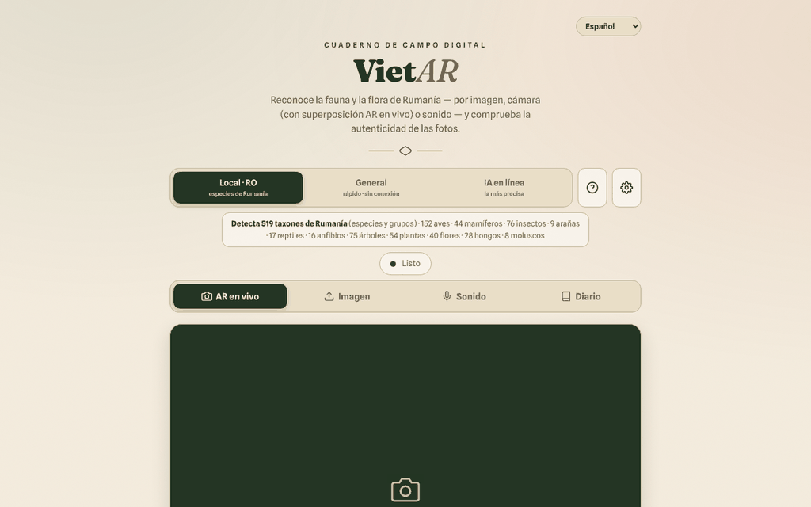

# VietAR — fauna y flora de Rumanía

[English](README.md) · [Română](README.ro.md) · [Français](README.fr.md) · [Italiano](README.it.md) · **Español** · [Português](README.pt.md) · [Deutsch](README.de.md) · [Magyar](README.hu.md)

**Versión:** 19.2.6 · **Última actualización:** 2026-10-23

Idiomas de la interfaz: **Română, English, Français, Italiano, Español, Português (PT), Deutsch, Magyar**

**En línea / demo:** https://chiuta.github.io/VietAR/

PWA en un único `index.html` (+ `vendor/`, `sw.js`, `manifest.webmanifest`): reconoce animales y plantas a partir de una fotografía, de la cámara (superposición «AR») o de un sonido, comprueba de forma orientativa las señales de procedencia C2PA de las imágenes y mantiene un diario de campo local (filtrable e imprimible). El motor local (CLIP, 519 taxones rumanos) se ejecuta en el navegador; también existe un modo opcional de «IA en línea».

**Atención: la identificación automática puede equivocarse. No consumas plantas ni hongos basándote en esta aplicación; algunas especies son tóxicas o mortales.** Los resultados son orientativos, no determinaciones científicas.

## Uso
Abre la página publicada (GitHub Pages) o sirve la carpeta con un servidor HTTP estático (por ejemplo `python3 -m http.server`). Desde `file://` el navegador bloquea los módulos ES: la interfaz, el diario y la exportación siguen siendo utilizables, y la aplicación muestra un mensaje claro de que la identificación no puede iniciarse (en lugar de un error en la consola). Elige el motor (Local·RO, General, IA en línea) y después: «AR en vivo» (cámara), «Imagen», «Sonido» o «Diario».

## Qué NO funciona sin conexión / qué datos salen del navegador
La aplicación funciona sin conexión solo tras la primera descarga de los modelos. No es 100 % local:
- **Modelos de identificación**: en el primer uso se descargan de `huggingface.co` (pesos de decenas a cientos de MB; el servidor ve la solicitud, la dirección IP y el user-agent, no tus imágenes). Después se conservan en la caché del navegador.
- **ONNX Runtime (WASM)**: solicitado por `transformers.js` a `cdn.jsdelivr.net` (véase `VENDOR-README-VietAR.md`). Las bibliotecas `transformers.js` y `c2pa` se incluyen localmente en `vendor/`.
- **C2PA**: la validación de la cadena de certificados puede contactar con `contentcredentials.org` (permitido en la CSP).
- **Modo «IA en línea» (opcional)**: si lo eliges e introduces una clave de API, **la imagen seleccionada se envía** a `api.anthropic.com` o `api.openai.com` (o a un endpoint compatible con OpenAI, sujeto a la CSP), tras una confirmación explícita. La clave de API se guarda en `localStorage` si no marcas «solo sesión»; usa únicamente claves con límite de gasto.
- El diario (observaciones, miniaturas, la ubicación GPS si la adjuntas) permanece solo en el navegador (`localStorage`/IndexedDB); puede exportarse en CSV/GeoJSON.
- No hay analítica ni telemetría en el código; la única solicitud al propio sitio es `version.json` (omitida en `file://`).

## Limitaciones
- El motor local compara el aspecto con una lista; no conoce las especies raras.
- La comprobación de autenticidad (C2PA/IA) es una señal orientativa; la ausencia de marcas no significa que la imagen sea auténtica.
- La CSP de la página ya no permite `'unsafe-inline'` para los scripts (el script propio se acepta mediante hash SHA-256); `connect-src` sigue siendo deliberadamente amplio, véase más abajo.

## Licencia
Código y textos propios del autor: TRADE-FREE + MIT (cabecera de `index.html`; véase `LICENSE`). Las bibliotecas de `vendor/` (transformers.js, c2pa-web, c2pa), ONNX Runtime cargado desde jsDelivr, los modelos descargados de huggingface.co y las fuentes incorporadas tienen **sus propias licencias y no están cubiertos por CC0**; la lista y las condiciones están en `NOTICE` (a reconfirmar desde los paquetes originales en cada actualización).

## Modo «IA en línea» (opt-in)
La imagen sale hacia terceros **solo** si: (1) eliges el motor «IA en línea», (2) introduces una clave de API propia y (3) confirmas en la ventana «Envío a la IA en línea». La confirmación se recuerda en este navegador hasta que pulses «Olvidar la clave ahora» en ⚙. Los motores «Local · RO» y «General» no envían imágenes a ningún sitio. Al cargar la página no se realiza ninguna solicitud externa (verificado). La CSP sigue siendo deliberadamente amplia en `connect-src` (huggingface.co, jsDelivr, Anthropic/OpenAI/OpenRouter, contentcredentials.org) porque cada host corresponde a una función opcional descrita arriba; `contentcredentials.org` no es contactado directamente por el código de la página, sino eventualmente por la biblioteca C2PA, motivo por el cual no lo he quitado.

Auditoría: 2026-10-10

## Historial / Changelog

### 19.2.6 — 2026-10-23
- fff-kit 1.2.0: los diálogos de confirmación (borrar el diario, endpoint de IA privado, importar el perfil, vaciar la caché) usan ahora el diálogo accesible común del kit (`FFF.dialog`) en lugar de una copia propia con alternativa nativa; las claves del navegador llevan el prefijo `vietar.` (`iff_cfg`, `iff_consent`, `iff_loc`, `iff_seen`, `vietar_lang` → `vietar.cfg`, `.consent`, `.loc`, `.seen`, `.lang`) y las antiguas se migran automáticamente al iniciar (también tras importar una copia .fff.json antigua): se conservan los ajustes de IA, el consentimiento y el idioma. `version.json` y la comprobación de versión de la página vuelven a estar alineados.

### 19.2.4 — 2026-10-22
- fff-kit 1.1.4: objetivos táctiles y texto mínimo; objetivos táctiles/texto corregidos

### 19.2.3 — 2026-10-22
- fff-kit 1.1.2: PBKDF2 con 600.000 iteraciones, protección anti-clickjacking.

### 19.2.2 — 2026-10-22
- Las tres confirmaciones bloqueantes del navegador (borrar el diario, predescargar los modelos, vaciar la caché) se sustituyen por diálogos modales traducidos (8 idiomas); la alerta de almacenamiento bloqueado pasa a ser una notificación.
- El punto de conexión de IA personalizado se valida al guardar: debe ser una dirección https:// completa, y una dirección local, privada o una IP pide confirmación antes de que las imágenes y la clave API puedan enviarse allí.
- Móvil: el texto mide al menos 12 px y los botones y campos tienen áreas táctiles mayores en pantallas estrechas.

### 19.1.0 — 2026-10-14
- Copia de seguridad y etiquetado de datos (fff-kit).

### 19.0.1 — 2026-10-12
- La versión y la fecha de la última actualización se muestran en la aplicación (pie de página); versión 19.0.1 en index.html, sw.js y version.json (numeración mayor v19 conservada).

### v19 — 11 de octubre de 2026 (ronda 7)
- Corregido: el mensaje genérico «Error en el análisis.» (cuando el modelo no puede descargarse) se sustituye por explicaciones distintas — ejecución desde `file://`, sin conexión, o fallo de descarga/inicio — además de detalles técnicos y el botón «↻ Reintentar el análisis» (probado con la red bloqueada en un servidor local).
- Versión v19 (index.html, sw.js, version.json); CSP: se recalculó el hash del script; `connect-src` sigue siendo deliberadamente amplio (modelos, ONNX Runtime, IA en línea opcional).

### v18 — 11 de octubre de 2026 (ronda 6)
- Añadido: un filtro de búsqueda en el Diario (especie, categoría, fecha) y un botón «Imprimir el diario» con un estilo de impresión que conserva solo las observaciones.
- Seguridad: CSP con `script-src` mediante hash en lugar de `'unsafe-inline'`; verificado mediante un servidor HTTP local (el módulo y la interfaz arrancan sin infracciones de la CSP).
- Versión v18 (index.html, sw.js, version.json).

### v17 — 11 de octubre de 2026
- Corregido: en `file://` transformers.js ya no se importa de forma estática (error CORS al iniciar); se carga bajo demanda, la interfaz sigue funcionando y aparece una advertencia visible con los pasos para un servidor HTTP local.
- Corregido: estructura con `<main>` y orden correcto de los títulos (h2 en ventanas y tarjetas); 0 infracciones de axe-core a 1280 y 360 px.
- Actualizado: versión v17 (index.html, sw.js, version.json), fecha 2026-10-11; verificado que el módulo se carga correctamente mediante un servidor HTTP local.
