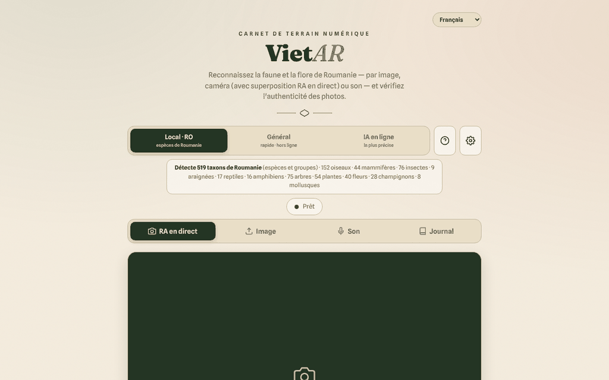

# VietAR — faune et flore de Roumanie

[English](README.md) · [Română](README.ro.md) · **Français** · [Italiano](README.it.md) · [Español](README.es.md) · [Português](README.pt.md) · [Deutsch](README.de.md) · [Magyar](README.hu.md)

**Version :** 19.2.3 · **Dernière mise à jour :** 2026-10-22

Langues de l'interface : **Română, English, Français, Italiano, Español, Português (PT), Deutsch, Magyar**

**En ligne / démo :** https://chiuta.github.io/VietAR/

PWA tenant dans un seul `index.html` (+ `vendor/`, `sw.js`, `manifest.webmanifest`) : elle reconnaît des animaux et des plantes à partir d'une photo, de la caméra (superposition « AR ») ou d'un son, vérifie à titre indicatif les signes de provenance C2PA des images et tient un journal de terrain local (filtrable et imprimable). Le moteur local (CLIP, 519 taxons roumains) s'exécute dans le navigateur ; un mode optionnel « IA en ligne » est également disponible.

**Attention : l'identification automatique peut se tromper. Ne consommez pas de plantes ni de champignons sur la base de cette application ; certaines espèces sont toxiques ou mortelles.** Les résultats sont indicatifs et ne constituent pas des déterminations scientifiques.

## Utilisation
Ouvrez la page publiée (GitHub Pages) ou servez le dossier avec un serveur HTTP statique (par exemple `python3 -m http.server`). Depuis `file://`, le navigateur bloque les modules ES : l'interface, le journal et l'export restent utilisables, et l'application affiche un message clair indiquant que l'identification ne peut pas démarrer (au lieu d'une erreur dans la console). Choisissez le moteur (Local·RO, Général, IA en ligne), puis : « AR en direct » (caméra), « Image », « Son » ou « Journal ».

## Ce qui n'est PAS hors ligne / quelles données quittent le navigateur
L'application ne fonctionne hors ligne qu'après le premier téléchargement des modèles. Elle n'est pas locale à 100 % :
- **Modèles d'identification** : à la première utilisation, ils sont téléchargés depuis `huggingface.co` (poids de dizaines à centaines de Mo ; le serveur voit la requête, l'adresse IP et le user-agent, pas vos images). Ils sont ensuite conservés dans le cache du navigateur.
- **ONNX Runtime (WASM)** : demandé par `transformers.js` à `cdn.jsdelivr.net` (voir `VENDOR-README-VietAR.md`). Les bibliothèques `transformers.js` et `c2pa` sont incluses localement dans `vendor/`.
- **C2PA** : la validation de la chaîne de certificats peut contacter `contentcredentials.org` (autorisé dans la CSP).
- **Mode « IA en ligne » (optionnel)** : si vous le choisissez et saisissez une clé API, **l'image sélectionnée est envoyée** à `api.anthropic.com` ou `api.openai.com` (ou à un point d'accès compatible OpenAI, soumis à la CSP), après une confirmation explicite. La clé API est conservée dans `localStorage` sauf si vous cochez « session uniquement » ; n'utilisez que des clés avec un plafond de dépenses.
- Le journal (observations, miniatures, position GPS si vous la joignez) reste uniquement dans le navigateur (`localStorage`/IndexedDB) ; il peut être exporté en CSV/GeoJSON.
- Il n'y a ni analytique ni télémétrie dans le code ; la seule requête vers le site lui-même est `version.json` (omise sur `file://`).

## Limites
- Le moteur local compare l'apparence à une liste ; il ne connaît pas les espèces rares.
- La vérification d'authenticité (C2PA/IA) est un signal indicatif ; l'absence de marqueurs ne signifie pas que l'image est authentique.
- La CSP de la page n'autorise plus `'unsafe-inline'` pour les scripts (le script propre est accepté par hachage SHA-256) ; `connect-src` reste volontairement large, voir plus bas.

## Licence
Code et textes propres de l'auteur : TRADE-FREE + MIT (en-tête de `index.html` ; voir `LICENSE`). Les bibliothèques de `vendor/` (transformers.js, c2pa-web, c2pa), ONNX Runtime chargé depuis jsDelivr, les modèles téléchargés depuis huggingface.co et les polices intégrées ont **leurs propres licences et ne sont pas couverts par CC0** ; la liste et les conditions figurent dans `NOTICE` (à reconfirmer à partir des paquets d'origine à chaque mise à jour).

## Mode « IA en ligne » (opt-in)
L'image n'est transmise à des tiers **que** si : (1) vous choisissez le moteur « IA en ligne », (2) vous saisissez votre propre clé API et (3) vous confirmez dans la fenêtre « Envoi vers l'IA en ligne ». La confirmation est retenue dans ce navigateur jusqu'à ce que vous appuyiez sur « Oublier la clé maintenant » dans ⚙. Les moteurs « Local · RO » et « Général » n'envoient aucune image nulle part. Au chargement de la page, aucune requête externe n'est effectuée (vérifié). La CSP reste volontairement large sur `connect-src` (huggingface.co, jsDelivr, Anthropic/OpenAI/OpenRouter, contentcredentials.org) car chaque hôte correspond à une fonction optionnelle décrite ci-dessus ; `contentcredentials.org` n'est pas contacté directement par le code de la page, mais éventuellement par la bibliothèque C2PA, raison pour laquelle je ne l'ai pas retiré.

Audit : 2026-10-10

## Historique / Changelog

### 19.2.3 — 2026-10-22
- fff-kit 1.1.2 : PBKDF2 à 600 000 itérations, protection anti-clickjacking.

### 19.2.2 — 2026-10-22
- Les trois confirmations bloquantes du navigateur (effacer le journal, pré-télécharger les modèles, vider le cache) sont remplacées par des dialogues modaux traduits (8 langues) ; l'alerte de stockage bloqué devient une notification.
- Le point de terminaison IA personnalisé est validé à l'enregistrement : il doit être une adresse https:// complète, et une adresse locale, privée ou une IP demande confirmation avant que les images et la clé API puissent y être envoyées.
- Mobile : le texte fait au moins 12 px et les boutons et champs ont des cibles tactiles plus grandes sur les écrans étroits.

### 19.1.0 — 2026-10-14
- Sauvegarde et étiquetage des données (fff-kit).

### 19.0.1 — 2026-10-12
- La version et la date de dernière mise à jour sont affichées dans l'application (pied de page) ; version 19.0.1 dans index.html, sw.js et version.json (numérotation majeure v19 conservée).

### v19 — 11 octobre 2026 (tour 7)
- Corrigé : le message générique « Erreur lors de l'analyse. » (lorsque le modèle ne peut pas être téléchargé) est remplacé par des explications distinctes — exécution depuis `file://`, hors ligne, ou échec du téléchargement/démarrage — ainsi que des détails techniques et le bouton « ↻ Relancer l'analyse » (testé avec le réseau bloqué sur un serveur local).
- Version v19 (index.html, sw.js, version.json) ; CSP : le hachage du script a été recalculé ; `connect-src` reste volontairement large (modèles, ONNX Runtime, IA en ligne optionnelle).

### v18 — 11 octobre 2026 (tour 6)
- Ajouté : un filtre de recherche dans le Journal (espèce, catégorie, date) et un bouton « Imprimer le journal » avec une feuille de style d'impression qui ne conserve que les observations.
- Sécurité : CSP avec `script-src` par hachage au lieu de `'unsafe-inline'` ; vérifié via un serveur HTTP local (le module et l'interface démarrent sans violation de la CSP).
- Version v18 (index.html, sw.js, version.json).

### v17 — 11 octobre 2026
- Corrigé : sur `file://`, transformers.js n'est plus importé statiquement (erreur CORS au démarrage) ; il est chargé à la demande, l'interface reste fonctionnelle et un avertissement visible présente les étapes pour un serveur HTTP local.
- Corrigé : structure avec `<main>` et ordre correct des titres (h2 dans les fenêtres et les cartes) ; 0 violation axe-core à 1280 et 360 px.
- Mis à jour : version v17 (index.html, sw.js, version.json), date 2026-10-11 ; vérification du bon chargement du module via un serveur HTTP local.
