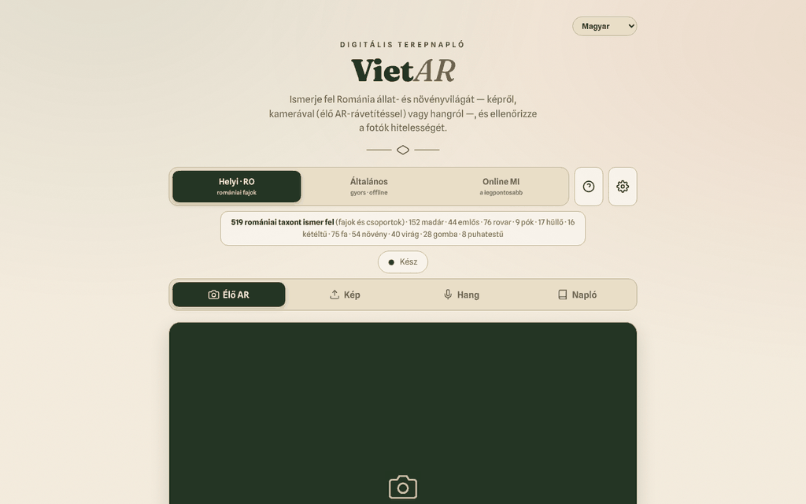

# VietAR — Románia faunája és flórája

[English](README.md) · [Română](README.ro.md) · [Français](README.fr.md) · [Italiano](README.it.md) · [Español](README.es.md) · [Português](README.pt.md) · [Deutsch](README.de.md) · **Magyar**

**Verzió:** 19.2.8 · **Utolsó frissítés:** 2026-10-26

A felület nyelvei: **Română, English, Français, Italiano, Español, Português (PT), Deutsch, Magyar**

**Online / bemutató:** https://chiuta.github.io/VietAR/

Egyetlen `index.html` fájlba csomagolt PWA (+ `vendor/`, `sw.js`, `manifest.webmanifest`): fényképről, kamerából („AR” rávetítés) vagy hangról ismeri fel az állatokat és növényeket, tájékoztató jelleggel ellenőrzi a képek C2PA-eredetjelzéseit, és helyi terepnaplót vezet (szűrhető és nyomtatható). A helyi motor (CLIP, 519 romániai taxon) a böngészőben fut; opcionálisan elérhető egy „online MI” mód is.

**Figyelem: az automatikus azonosítás tévedhet. Ne fogyassz növényt vagy gombát ennek az alkalmazásnak az alapján; egyes fajok mérgezőek vagy halálosak.** Az eredmények tájékoztató jellegűek, nem tudományos meghatározások.

## Használat
Nyisd meg a közzétett oldalt (GitHub Pages), vagy szolgáld ki a mappát egy statikus HTTP-szerverrel (például `python3 -m http.server`). `file://` esetén a böngésző blokkolja az ES-modulokat: a felület, a napló és az exportálás használható marad, az alkalmazás pedig egyértelmű üzenetben jelzi, hogy az azonosítás nem indítható el (konzolhiba helyett). Válaszd ki a motort (Helyi·RO, Általános, Online MI), majd: „Élő AR” (kamera), „Kép”, „Hang” vagy „Napló”.

## Ami NEM működik offline / mely adatok hagyják el a böngészőt
Az alkalmazás csak a modellek első letöltése után működik offline. Nem 100%-ban helyi:
- **Azonosító modellek**: első használatkor a `huggingface.co`-ról töltődnek le (több tíz–száz MB méretű súlyok; a szerver látja a kérést, az IP-címet és a user-agentet, a képeidet nem). Ezután a böngésző gyorsítótárában maradnak.
- **ONNX Runtime (WASM)**: a `transformers.js` kéri a `cdn.jsdelivr.net`-ről (lásd `VENDOR-README-VietAR.md`). A `transformers.js` és a `c2pa` könyvtár helyben, a `vendor/` mappában található.
- **C2PA**: a tanúsítványlánc ellenőrzése felveheti a kapcsolatot a `contentcredentials.org`-gal (a CSP engedélyezi).
- **„Online MI” mód (opcionális)**: ha ezt választod, és megadsz egy API-kulcsot, **a kiválasztott kép elküldésre kerül** az `api.anthropic.com` vagy az `api.openai.com` címre (illetve egy OpenAI-kompatibilis végpontra, a CSP korlátai szerint), kifejezett megerősítés után. Az API-kulcs a `localStorage`-ban marad, hacsak nem jelölöd be a „csak munkamenet” lehetőséget; csak költési korláttal rendelkező kulcsot használj.
- A napló (megfigyelések, bélyegképek, a GPS-helyzet, ha csatolod) kizárólag a böngészőben marad (`localStorage`/IndexedDB); CSV/GeoJSON formátumban exportálható.
- A kódban nincs analitika vagy telemetria; a saját oldal felé irányuló egyetlen kérés a `version.json` (`file://` esetén kimarad).

## Korlátozások
- A helyi motor a megjelenést egy listához hasonlítja; a ritka fajokat nem ismeri.
- A hitelességi ellenőrzés (C2PA/MI) tájékoztató jelzés; a jelölések hiánya nem jelenti azt, hogy a kép hiteles.
- Az oldal CSP-je már nem engedélyezi a `'unsafe-inline'` használatát szkriptekhez (a saját szkriptet SHA-256 hash alapján fogadja el); a `connect-src` szándékosan tág marad, lásd alább.

## Licenc
A szerző kódja és saját szövegei: TRADE-FREE + MIT (az `index.html` fejléce; lásd `LICENSE`). A `vendor/` mappa könyvtárai (transformers.js, c2pa-web, c2pa), a jsDelivrről betöltött ONNX Runtime, a huggingface.co-ról letöltött modellek és a beágyazott betűtípusok **saját licenccel rendelkeznek, és a CC0 nem vonatkozik rájuk**; a lista és a feltételek a `NOTICE` fájlban találhatók (minden frissítéskor újra megerősítendő az eredeti csomagokból).

## „Online MI” mód (opt-in)
A kép **csak akkor** kerül harmadik félhez, ha: (1) az „Online MI” motort választod, (2) megadod a saját API-kulcsodat, és (3) megerősíted az „Küldés az online MI-nek” ablakban. A megerősítést ez a böngésző megjegyzi, amíg a ⚙ menüben meg nem nyomod a „Kulcs elfelejtése most” gombot. A „Helyi · RO” és az „Általános” motor sehová nem küld képet. Az oldal betöltésekor nem történik külső kérés (ellenőrizve). A CSP a `connect-src` esetében szándékosan tág marad (huggingface.co, jsDelivr, Anthropic/OpenAI/OpenRouter, contentcredentials.org), mert minden gazdagép a fent leírt egy-egy opcionális funkciónak felel meg; a `contentcredentials.org`-ot az oldal kódja nem közvetlenül hívja, legfeljebb a C2PA könyvtár, ezért nem távolítottam el.

Audit: 2026-10-10

## Előzmények / Changelog

### 19.2.7 — 2026-10-23
- Online MI mód: a származási (C2PA/metaadat) sor soha nem jelent meg a második „Hitelesség” kártyán (nem létező mezőt olvasott); most megjelenik. A modell „alternatívái” között egy `null` vagy nem objektum elem már nem dobja el az egész eredményt.
- Napló-CSV: a negatív szélességi/hosszúsági fokokat a képlet-védelem már nem alakítja szöveggé.

### 19.2.6 — 2026-10-23
- fff-kit 1.2.0: a megerősítő párbeszédek (napló törlése, privát MI-végpont, profilimport, gyorsítótár ürítése) mostantól a készlet közös, akadálymentes párbeszédablakát (`FFF.dialog`) használják a natív tartalékkal rendelkező saját másolat helyett; a böngészőkulcsok `vietar.` előtagot kapnak (`iff_cfg`, `iff_consent`, `iff_loc`, `iff_seen`, `vietar_lang` → `vietar.cfg`, `.consent`, `.loc`, `.seen`, `.lang`), a régieket az alkalmazás induláskor automatikusan átköltözteti (régi .fff.json mentés importálása után is), így a mentett MI-beállítások, a hozzájárulás és a nyelv megmaradnak. A `version.json` és az oldalon belüli verzióellenőrzés újra egyezik.

### 19.2.4 — 2026-10-22
- fff-kit 1.1.4: érintési célpontok és minimális szövegméret; érintési célpontok/szöveg javítva

### 19.2.3 — 2026-10-22
- fff-kit 1.1.2: PBKDF2 600 000 iterációval, clickjacking elleni védelem.

### 19.2.2 — 2026-10-22
- A három blokkoló böngészőmegerősítést (napló törlése, modellek előzetes letöltése, gyorsítótár ürítése) lefordított modális ablakok váltják fel (8 nyelv); a blokkolt tárhelyről szóló riasztás mostantól értesítés.
- Az egyéni MI-végpontot mentéskor ellenőrzi az alkalmazás: teljes https:// címnek kell lennie, a helyi, privát vagy IP-cím pedig megerősítést kér, mielőtt a képek és az API-kulcs oda elküldhetők.
- Mobil: a szöveg legalább 12 px, a gombok és mezők érintési felülete pedig nagyobb keskeny képernyőn.

### 19.1.0 — 2026-10-14
- Adatmentés és adatcímkézés (fff-kit).

### 19.0.1 — 2026-10-12
- A verzió és az utolsó frissítés dátuma megjelenik az alkalmazásban (lábléc); a 19.0.1 verzió az index.html, az sw.js és a version.json fájlban (a v19 főverzió-számozás megmaradt).

### v19 — 2026. október 11. (7. forduló)
- Javítva: az általános „Hiba az elemzés során.” üzenetet (amikor a modell nem tölthető le) külön magyarázatok váltják fel — futtatás `file://` alól, offline állapot, vagy letöltési/indítási hiba —, valamint technikai részletek és a „↻ Elemzés újrapróbálása” gomb (helyi szerveren, letiltott hálózattal tesztelve).
- v19 verzió (index.html, sw.js, version.json); CSP: a szkript hash-ét újraszámoltuk; a `connect-src` szándékosan tág marad (modellek, ONNX Runtime, opcionális online MI).

### v18 — 2026. október 11. (6. forduló)
- Hozzáadva: keresőszűrő a Naplóban (faj, kategória, dátum) és „Napló nyomtatása” gomb olyan nyomtatási stílussal, amely csak a megfigyeléseket tartja meg.
- Biztonság: CSP `script-src` hash alapján `'unsafe-inline'` helyett; helyi HTTP-szerveren ellenőrizve (a modul és a felület CSP-sértés nélkül indul).
- v18 verzió (index.html, sw.js, version.json).

### v17 — 2026. október 11.
- Javítva: `file://` alatt a transformers.js már nem statikusan importálódik (CORS-hiba induláskor); igény szerint töltődik be, a felület működőképes marad, és látható figyelmeztetés ismerteti a helyi HTTP-szerver lépéseit.
- Javítva: `<main>` elemet használó szerkezet és helyes címsor-sorrend (h2 az ablakokban és a kártyákon); 0 axe-core hiba 1280 és 360 px szélességnél.
- Frissítve: v17 verzió (index.html, sw.js, version.json), dátum 2026-10-11; ellenőrizve, hogy a modul helyesen töltődik be helyi HTTP-szerveren keresztül.
