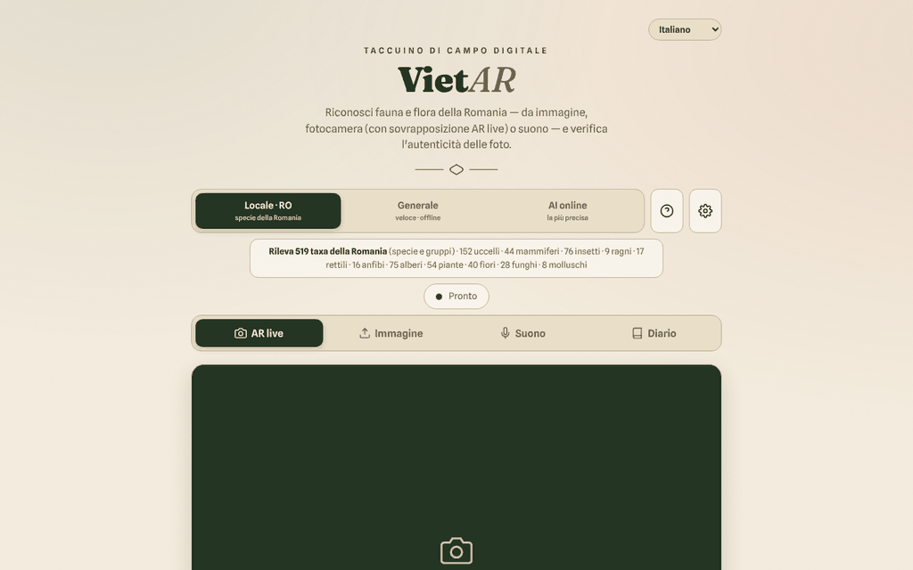

# VietAR — fauna e flora della Romania

[English](README.md) · [Română](README.ro.md) · [Français](README.fr.md) · **Italiano** · [Español](README.es.md) · [Português](README.pt.md) · [Deutsch](README.de.md) · [Magyar](README.hu.md)

**Versione:** 19.2.3 · **Ultimo aggiornamento:** 2026-10-22

Lingue dell'interfaccia: **Română, English, Français, Italiano, Español, Português (PT), Deutsch, Magyar**

**Online / demo:** https://chiuta.github.io/VietAR/

PWA in un unico `index.html` (+ `vendor/`, `sw.js`, `manifest.webmanifest`): riconosce animali e piante da una fotografia, dalla fotocamera (sovrapposizione «AR») o dal suono, verifica in modo indicativo i segnali di provenienza C2PA delle immagini e tiene un diario di campo locale (filtrabile e stampabile). Il motore locale (CLIP, 519 taxa rumeni) funziona nel browser; è disponibile anche una modalità facoltativa «IA online».

**Attenzione: l'identificazione automatica può sbagliare. Non consumare piante o funghi sulla base di questa applicazione; alcune specie sono tossiche o mortali.** I risultati sono indicativi, non sono determinazioni scientifiche.

## Utilizzo
Apri la pagina pubblicata (GitHub Pages) oppure servi la cartella con un server HTTP statico (ad esempio `python3 -m http.server`). Da `file://` il browser blocca i moduli ES: l'interfaccia, il diario e l'esportazione restano utilizzabili, e l'applicazione mostra un messaggio chiaro che l'identificazione non può partire (invece di un errore nella console). Scegli il motore (Local·RO, Generale, IA online), poi: «AR dal vivo» (fotocamera), «Immagine», «Suono» o «Diario».

## Cosa NON è offline / quali dati lasciano il browser
L'applicazione funziona offline solo dopo il primo scaricamento dei modelli. Non è locale al 100%:
- **Modelli di identificazione**: al primo utilizzo vengono scaricati da `huggingface.co` (pesi da decine a centinaia di MB; il server vede la richiesta, l'indirizzo IP e lo user-agent, non le tue immagini). Poi vengono conservati nella cache del browser.
- **ONNX Runtime (WASM)**: richiesto da `transformers.js` a `cdn.jsdelivr.net` (vedi `VENDOR-README-VietAR.md`). Le librerie `transformers.js` e `c2pa` sono incluse localmente in `vendor/`.
- **C2PA**: la convalida della catena di certificati può contattare `contentcredentials.org` (consentito nella CSP).
- **Modalità «IA online» (facoltativa)**: se la scegli e inserisci una chiave API, **l'immagine selezionata viene inviata** a `api.anthropic.com` o `api.openai.com` (o a un endpoint compatibile con OpenAI, soggetto alla CSP), dopo una conferma esplicita. La chiave API è conservata in `localStorage` se non spunti «solo sessione»; usa solo chiavi con un limite di spesa.
- Il diario (osservazioni, miniature, la posizione GPS se la alleghi) rimane solo nel browser (`localStorage`/IndexedDB); può essere esportato in CSV/GeoJSON.
- Nel codice non ci sono analytics né telemetria; l'unica richiesta verso il sito stesso è `version.json` (omessa su `file://`).

## Limitazioni
- Il motore locale confronta l'aspetto con un elenco; non conosce le specie rare.
- La verifica di autenticità (C2PA/IA) è un segnale indicativo; l'assenza di marcature non significa che l'immagine sia autentica.
- La CSP della pagina non consente più `'unsafe-inline'` per gli script (lo script proprio è accettato tramite hash SHA-256); `connect-src` resta volutamente ampio, vedi più sotto.

## Licenza
Codice e testi propri dell'autore: TRADE-FREE + MIT (intestazione di `index.html`; vedi `LICENSE`). Le librerie in `vendor/` (transformers.js, c2pa-web, c2pa), l'ONNX Runtime caricato da jsDelivr, i modelli scaricati da huggingface.co e i font incorporati hanno **licenze proprie e non sono coperti da CC0**; l'elenco e le condizioni sono in `NOTICE` (da riconfermare dai pacchetti originali a ogni aggiornamento).

## Modalità «IA online» (opt-in)
L'immagine parte verso terzi **solo** se: (1) scegli il motore «IA online», (2) inserisci una tua chiave API e (3) confermi nella finestra «Invio all'IA online». La conferma viene ricordata in questo browser finché non premi «Dimentica la chiave adesso» in ⚙. I motori «Local · RO» e «Generale» non inviano immagini da nessuna parte. Al caricamento della pagina non viene effettuata alcuna richiesta esterna (verificato). La CSP rimane volutamente ampia su `connect-src` (huggingface.co, jsDelivr, Anthropic/OpenAI/OpenRouter, contentcredentials.org) poiché ogni host corrisponde a una funzione facoltativa descritta sopra; `contentcredentials.org` non è contattato direttamente dal codice della pagina, ma eventualmente dalla libreria C2PA, motivo per cui non l'ho rimosso.

Audit: 2026-10-10

## Cronologia / Changelog

### 19.2.3 — 2026-10-22
- fff-kit 1.1.2: PBKDF2 a 600.000 iterazioni, protezione anti-clickjacking.

### 19.2.2 — 2026-10-22
- Le tre conferme bloccanti del browser (cancellare il diario, pre-scaricare i modelli, svuotare la cache) sono sostituite da finestre modali tradotte (8 lingue); l'avviso di archiviazione bloccata diventa una notifica.
- L'endpoint IA personalizzato viene convalidato al salvataggio: deve essere un indirizzo https:// completo e un indirizzo locale, privato o un IP richiede conferma prima che immagini e chiave API possano essere inviate lì.
- Mobile: il testo è di almeno 12 px e pulsanti e campi hanno aree tattili più grandi sugli schermi stretti.

### 19.1.0 — 2026-10-14
- Backup ed etichettatura dei dati (fff-kit).

### 19.0.1 — 2026-10-12
- La versione e la data dell'ultimo aggiornamento sono mostrate nell'applicazione (piè di pagina); versione 19.0.1 in index.html, sw.js e version.json (numerazione maggiore v19 mantenuta).

### v19 — 11 ottobre 2026 (giro 7)
- Corretto: il messaggio generico «Errore durante l'analisi.» (quando il modello non può essere scaricato) è sostituito da spiegazioni distinte — esecuzione da `file://`, offline, oppure errore di scaricamento/avvio — più dettagli tecnici e il pulsante «↻ Riprova l'analisi» (testato con la rete bloccata su un server locale).
- Versione v19 (index.html, sw.js, version.json); CSP: l'hash dello script è stato ricalcolato; `connect-src` resta volutamente ampio (modelli, ONNX Runtime, IA online facoltativa).

### v18 — 11 ottobre 2026 (giro 6)
- Aggiunto: un filtro di ricerca nel Diario (specie, categoria, data) e un pulsante «Stampa il diario» con uno stile di stampa che mantiene solo le osservazioni.
- Sicurezza: CSP con `script-src` tramite hash al posto di `'unsafe-inline'`; verificato tramite un server HTTP locale (il modulo e l'interfaccia si avviano senza violazioni della CSP).
- Versione v18 (index.html, sw.js, version.json).

### v17 — 11 ottobre 2026
- Corretto: su `file://` transformers.js non viene più importato staticamente (errore CORS all'avvio); viene caricato su richiesta, l'interfaccia resta funzionante e compare un avviso visibile con i passaggi per un server HTTP locale.
- Corretto: struttura con `<main>` e ordine corretto dei titoli (h2 nelle finestre e nelle schede); 0 violazioni axe-core a 1280 e 360 px.
- Aggiornato: versione v17 (index.html, sw.js, version.json), data 2026-10-11; verificato il corretto caricamento del modulo tramite un server HTTP locale.
