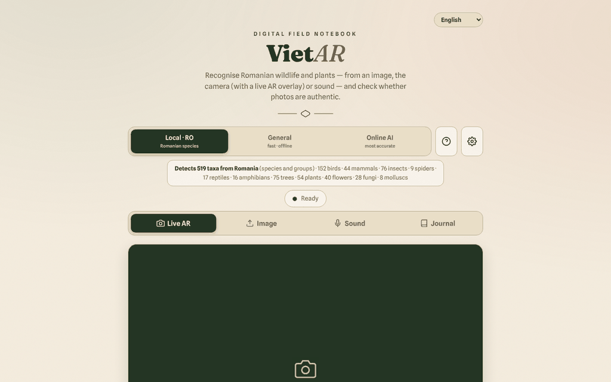

# VietAR — fauna and flora of Romania

**English** · [Română](README.ro.md) · [Français](README.fr.md) · [Italiano](README.it.md) · [Español](README.es.md) · [Português](README.pt.md) · [Deutsch](README.de.md) · [Magyar](README.hu.md)

**Version:** 20.2.0 · **Last updated:** 2026-10-27

**Status:** experimental · **Offline:** complete only after the first use: it needs internet once for the models (huggingface.co) and the ONNX Runtime (cdn.jsdelivr.net), then works from the cache

Interface languages: **Română, English, Français, Italiano, Español, Português (PT), Deutsch, Magyar**

**Live / demo:** https://chiuta.github.io/VietAR/

A PWA in a single `index.html` (+ `vendor/`, `sw.js`, `manifest.webmanifest`): it recognises animals and plants from a photo, the camera ("AR" overlay) or sound, gives an indicative check of the C2PA provenance signals of images, and keeps a local field journal (filterable and printable). The local engine (CLIP, 519 Romanian taxa) runs in the browser; an optional "online AI" mode is also available.

**Warning: automatic identification can be wrong. Do not eat plants or mushrooms on the basis of this application; some species are toxic or deadly.** The results are indicative, not scientific determinations.

## Usage
Open the published page (GitHub Pages) or serve the folder with a static HTTP server (for example `python3 -m http.server`). From `file://` the browser blocks ES modules: the interface, the journal and the export remain usable, and the application shows a clear message that identification cannot start (instead of a console error). Choose the engine (Local·RO, General, Online AI), then: "Live AR" (camera), "Image", "Sound" or "Journal".

## Identification journal (20.0.0)
Every saved observation now keeps its **confidence level** (good / fair / weak match; "indicative" for fungi, with no percentage), the **close alternatives** from the same result (up to 3, with a percentage only when the engine provides one) and the **reasons they may be confused**: same genus, same category, close score, identified only at group level. The reasons are computed from the app's own data (scientific name, category, score) and **do not describe the actual features of the species**. You can add your own note, filter by level and export everything to CSV/GeoJSON (the new columns come last). Older entries stay valid. The warning stays: **do not eat or touch anything based on an automatic identification; confirm with a specialist.**

## What is NOT offline / what data leaves the browser
The application works offline only after the models have been downloaded for the first time. It is not 100% local:
- **Identification models**: on first use they are downloaded from `huggingface.co` (weights of tens to hundreds of MB; the server sees the request, the IP address and the user agent, not your images). They are then kept in the browser cache.
- **ONNX Runtime (WASM)**: requested by `transformers.js` from `cdn.jsdelivr.net` (see `VENDOR-README-VietAR.md`). The `transformers.js` and `c2pa` libraries are included locally in `vendor/`.
- **C2PA**: validation of the certificate chain may contact `contentcredentials.org` (allowed in the CSP).
- **"Online AI" mode (optional)**: if you choose it and enter an API key, **the selected image is sent** to `api.anthropic.com` or `api.openai.com` (or an OpenAI-compatible endpoint, subject to the CSP), after an explicit confirmation. The API key is kept in `localStorage` unless you tick "session only"; use only keys with a spending limit.
- The journal (observations, thumbnails, the GPS location if you attach it) stays only in the browser (`localStorage`/IndexedDB); it can be exported as CSV/GeoJSON.
- There is no analytics or telemetry in the code; the only request to the site itself is `version.json` (skipped on `file://`).

## Limitations
- The local engine compares appearance against a list; it does not know rare species.
- The authenticity check (C2PA/AI) is an indicative signal; the absence of markers does not mean the image is authentic.
- The CSP on the page no longer allows `'unsafe-inline'` for scripts (the author's own script is accepted by SHA-256 hash); `connect-src` remains deliberately broad, see below.

## Models, accuracy and offline cache (20.1.0)

- **Model source (read from the code).** Engine "local" = CLIP zero-shot (`Xenova/clip-vit-base-patch16`); engine "general" = `Xenova/vit-base-patch16-224`; sound = `Xenova/ast-finetuned-audioset-10-10-0.4593`. All are loaded with `transformers.js` 3.8.1 (bundled in `vendor/`) from `huggingface.co` as ONNX conversions published under the `Xenova` account; the original authors and the licence of each model must be confirmed on its model card: **to be verified**.
- **Accuracy: to be verified.** No measured accuracy, per species or overall, exists in the code or in this repository, and none is claimed here. The interface shows only a qualitative confidence level (good / fair / weak match), not a validated rate. Rare species are not covered (see Limitations).
- **Offline cache.** `transformers.js` keeps the downloaded models in the browser's Cache API (`useBrowserCache`). New in 20.1.0: after "Prepare offline" the app asks the browser for persistent storage (`navigator.storage.persist()`), so the cache is less likely to be evicted; the browser may refuse, and the "clear caches" button still removes everything. No dependency added; nothing leaves the browser.

## Licence
The author's code and own texts: TRADE-FREE + MIT (the header of `index.html`; see `LICENSE`). The libraries in `vendor/` (transformers.js, c2pa-web, c2pa), the ONNX Runtime loaded from jsDelivr, the models downloaded from huggingface.co and the embedded fonts have **their own licences and are not covered by CC0**; the list and the terms are in `NOTICE` (to be reconfirmed from the original packages at every update).

## "Online AI" mode (opt-in)
The image leaves for third parties **only** if: (1) you choose the "Online AI" engine, (2) you enter your own API key and (3) you confirm in the "Send to online AI" dialog. The confirmation is remembered in this browser until you press "Forget the key now" in ⚙. The "Local · RO" and "General" engines do not send images anywhere. When the page loads, no external request is made (verified). The CSP remains deliberately broad on `connect-src` (huggingface.co, jsDelivr, Anthropic/OpenAI/OpenRouter, contentcredentials.org) because each host corresponds to an optional feature described above; `contentcredentials.org` is not contacted directly by the page's code, only possibly by the C2PA library, which is why I did not remove it.

Audit: 2026-10-10

## Model origin and licences (20.2.0)

Documented in `NOTICE` and here, only as far as it could be verified on the web on 27 Oct 2026:

- **CLIP** ("local" engine): original model by OpenAI, paper arXiv 2103.00020. Licence of the weights: to be verified.
- **ViT** ("general" engine): the original `google/vit-base-patch16-224` (Google) carries the **apache-2.0** tag on huggingface.co (verified).
- **AST** (sound): the original `MIT/ast-finetuned-audioset-10-10-0.4593`; BSD-3-Clause according to a third-party page, not confirmed on the official card.
- The app loads the **ONNX conversions published under the `Xenova` account**; the licence of each conversion was **not verified** (the Xenova cards could not be opened), so it stays "to be verified".
- Per-species accuracy: still unmeasured, hence not stated.

## History / Changelog

### 20.2.0 — 2026-10-27
- Model origin and licences documented as far as verified; Xenova conversions remain to be verified.

### 20.0.0 — 2026-10-26
- Identification journal: confidence level, close alternatives, reasons for confusion (computed from data), own note, level filter, extended export.

### 19.2.7 — 2026-10-23
- Online AI mode: the provenance (C2PA/metadata) line was never shown in the second “Authenticity” card (it read a field that does not exist); it is now. A `null` or non-object entry in the model's “alternatives” no longer throws away the whole result.
- Journal CSV: negative latitude/longitude are no longer turned into text by the formula-injection guard.

### 19.2.6 — 2026-10-23
- fff-kit 1.2.0: the confirmation dialogs (clear journal, private AI endpoint, profile import, clear cache) now use the kit's shared accessible dialog (`FFF.dialog`) instead of an own copy with a native fallback; browser keys now carry the `vietar.` prefix (`iff_cfg`, `iff_consent`, `iff_loc`, `iff_seen`, `vietar_lang` → `vietar.cfg`, `.consent`, `.loc`, `.seen`, `.lang`) and the old ones are migrated automatically at start-up (also after importing an old .fff.json backup), so the saved AI settings, consent and language are kept. The `version.json` / in-page version check are aligned again.

### 19.2.4 — 2026-10-22
- fff-kit 1.1.4: touch targets and minimum text size; touch targets/text fixed

### 19.2.3 — 2026-10-22
- fff-kit 1.1.2: PBKDF2 600,000 iterations, anti-clickjacking protection.

### 19.2.2 — 2026-10-22
- The three blocking browser confirmations (clear journal, pre-download models, clear cache) are replaced by translated modal dialogs (8 languages); the storage-blocked alert is now a toast.
- The custom AI endpoint is validated when saving: it must be a complete https:// address, and an address that is local, private or an IP literal asks for confirmation before images and the API key can be sent there.
- Mobile: text is at least 12 px and buttons and fields have larger touch targets on narrow screens.

### 19.1.0 — 2026-10-14
- Backup and data labelling (fff-kit).

### 19.0.1 — 2026-10-12
- The version and the last-updated date are shown in the application (footer); version 19.0.1 in index.html, sw.js and version.json (major numbering v19 kept).

### v19 — 11 October 2026 (round 7)
- Fixed: the generic message "Analysis error." (when the model cannot be downloaded) is replaced by distinct explanations — running from `file://`, offline, or download/start-up failure — plus technical details and the "↻ Retry analysis" button (tested with the network blocked on a local server).
- Version v19 (index.html, sw.js, version.json); CSP: the script hash was recalculated; `connect-src` remains deliberately broad (models, ONNX Runtime, optional online AI).

### v18 — 11 October 2026 (round 6)
- Added: a search filter in the Journal (species, category, date) and a "Print the journal" button with a print style that keeps only the observations.
- Security: CSP with `script-src` by hash instead of `'unsafe-inline'`; verified through a local HTTP server (the module and the interface start without CSP violations).
- Version v18 (index.html, sw.js, version.json).

### v17 — 11 October 2026
- Fixed: on `file://` transformers.js is no longer imported statically (CORS error at start-up); it is loaded on demand, the interface stays functional and a visible warning appears with the steps for a local HTTP server.
- Fixed: structure with `<main>` and correct heading order (h2 in dialogs and cards); 0 axe-core violations at 1280 and 360 px.
- Updated: version v17 (index.html, sw.js, version.json), date 2026-10-11; verified that the module loads correctly through a local HTTP server.
