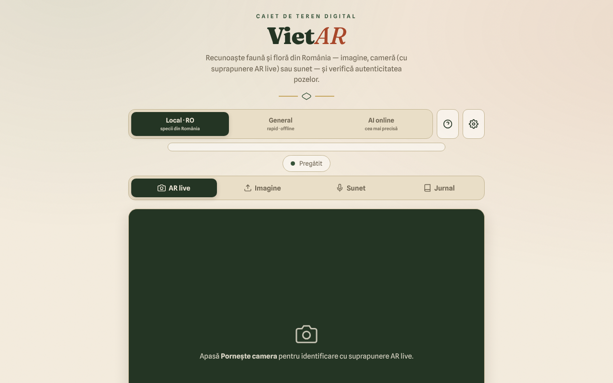

# VietAR — faună și floră din România

**Live / demo:** https://chiuta.github.io/VietAR/

PWA într-un `index.html` (+ `vendor/`, `sw.js`, `manifest.webmanifest`): recunoaște animale și plante din fotografie, cameră (suprapunere „AR”) sau sunet, verifică orientativ semnele de proveniență C2PA ale imaginilor și ține un jurnal de teren local. Motorul local (CLIP, 519 taxoni românești) rulează în browser; opțional există un mod „AI online”.

**Atenție: identificarea automată poate greși. Nu consuma plante sau ciuperci pe baza acestei aplicații; unele specii sunt toxice sau mortale.** Rezultatele sunt orientative, nu determinări științifice.

## Utilizare
Deschide pagina publicată (GitHub Pages) sau servește folderul cu un server HTTP static (modulele nu se încarcă corect de la `file://`). Alege motorul (Local·RO, General, AI online), apoi: „AR live” (cameră), „Imagine”, „Sunet” sau „Jurnal”.

## Ce NU este offline / ce date pleacă din browser
Aplicația funcționează offline doar după prima descărcare a modelelor. Nu este 100% locală:
- **Modele de identificare**: la prima utilizare se descarcă de pe `huggingface.co` (greutăți de zeci–sute de MB; serverul vede cererea, adresa IP și user-agent-ul, nu imaginile tale). Apoi sunt păstrate în cache-ul browserului.
- **ONNX Runtime (WASM)**: cerut de `transformers.js` de la `cdn.jsdelivr.net` (vezi `VENDOR-README-VietAR.md`). Bibliotecile `transformers.js` și `c2pa` sunt incluse local în `vendor/`.
- **C2PA**: validarea lanțului de certificate poate contacta `contentcredentials.org` (permis în CSP).
- **Mod „AI online” (opțional)**: dacă îl alegi și introduci o cheie API, **imaginea selectată este trimisă** către `api.anthropic.com` sau `api.openai.com` (sau un endpoint compatibil OpenAI, supus CSP), după o confirmare explicită. Cheia API este păstrată în `localStorage` dacă nu bifezi „doar sesiune”; folosește doar chei cu limită de cheltuieli.
- Jurnalul (observații, miniaturi, locația GPS dacă o atașezi) rămâne doar în browser (`localStorage`/IndexedDB); poate fi exportat CSV/GeoJSON.
- Nu există analytics sau telemetrie în cod; singura cerere către propriul site este `version.json`.

## Limitări
- Motorul local compară aspectul cu o listă; nu cunoaște specii rare.
- Verificarea de autenticitate (C2PA/AI) e semnal orientativ; absența marcajelor nu înseamnă că imaginea e autentică.
- CSP-ul din pagină permite `'unsafe-inline'` pentru scripturi.

## Licență
Codul și textele proprii ale autorului: TRADE-FREE + CC0 1.0 (antetul din `index.html`; vezi `LICENSE`). Bibliotecile din `vendor/` (transformers.js, c2pa-web, c2pa), ONNX Runtime încărcat de la jsDelivr, modelele descărcate de pe huggingface.co și fonturile încorporate au **propriile licențe și nu sunt acoperite de CC0**; lista și condițiile sunt în `NOTICE` (de reconfirmat din pachetele originale la fiecare actualizare).

## Modul „AI online” (opt-in)
Imaginea pleacă spre terți **numai** dacă: (1) alegi motorul „AI online”, (2) introduci o cheie API proprie și (3) confirmi în fereastra „Trimitere către AI online”. Confirmarea se reține în acest browser până apeși „Uită cheia acum” în ⚙. Motoarele „Local · RO” și „General” nu trimit imagini nicăieri. La încărcarea paginii nu se face nicio cerere externă (verificat). CSP rămâne larg intenționat pe `connect-src` (huggingface.co, jsDelivr, Anthropic/OpenAI/OpenRouter, contentcredentials.org) fiindcă fiecare gazdă corespunde unei funcții opționale descrise mai sus; `contentcredentials.org` nu este contactat direct de codul paginii, ci doar eventual de biblioteca C2PA, motiv pentru care nu l-am scos.

Audit: 2026-10-10
