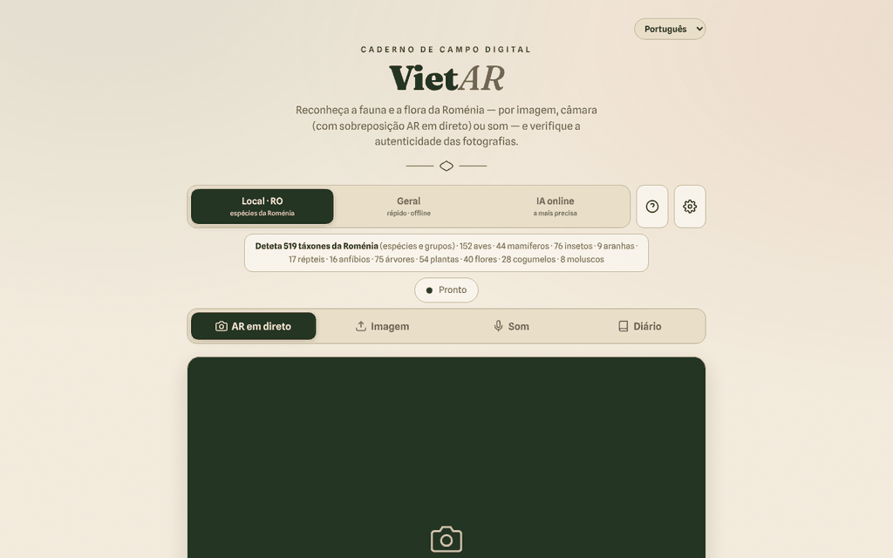

# VietAR — fauna e flora da Roménia

[English](README.md) · [Română](README.ro.md) · [Français](README.fr.md) · [Italiano](README.it.md) · [Español](README.es.md) · **Português** · [Deutsch](README.de.md) · [Magyar](README.hu.md)

**Versão:** 19.2.2 · **Última atualização:** 2026-10-22

Idiomas da interface: **Română, English, Français, Italiano, Español, Português (PT), Deutsch, Magyar**

**Online / demonstração:** https://chiuta.github.io/VietAR/

PWA num único `index.html` (+ `vendor/`, `sw.js`, `manifest.webmanifest`): reconhece animais e plantas a partir de uma fotografia, da câmara (sobreposição «AR») ou de um som, verifica de forma indicativa os sinais de proveniência C2PA das imagens e mantém um diário de campo local (filtrável e imprimível). O motor local (CLIP, 519 táxones romenos) corre no navegador; existe também um modo opcional de «IA online».

**Atenção: a identificação automática pode errar. Não consuma plantas nem cogumelos com base nesta aplicação; algumas espécies são tóxicas ou mortais.** Os resultados são indicativos, não são determinações científicas.

## Utilização
Abra a página publicada (GitHub Pages) ou sirva a pasta com um servidor HTTP estático (por exemplo `python3 -m http.server`). A partir de `file://` o navegador bloqueia os módulos ES: a interface, o diário e a exportação continuam utilizáveis, e a aplicação mostra uma mensagem clara de que a identificação não pode arrancar (em vez de um erro na consola). Escolha o motor (Local·RO, Geral, IA online) e depois: «AR em direto» (câmara), «Imagem», «Som» ou «Diário».

## O que NÃO funciona offline / que dados saem do navegador
A aplicação só funciona offline após a primeira transferência dos modelos. Não é 100% local:
- **Modelos de identificação**: na primeira utilização são descarregados de `huggingface.co` (pesos de dezenas a centenas de MB; o servidor vê o pedido, o endereço IP e o user-agent, não as suas imagens). Depois ficam guardados na cache do navegador.
- **ONNX Runtime (WASM)**: pedido pelo `transformers.js` a `cdn.jsdelivr.net` (ver `VENDOR-README-VietAR.md`). As bibliotecas `transformers.js` e `c2pa` estão incluídas localmente em `vendor/`.
- **C2PA**: a validação da cadeia de certificados pode contactar `contentcredentials.org` (permitido na CSP).
- **Modo «IA online» (opcional)**: se o escolher e introduzir uma chave de API, **a imagem selecionada é enviada** para `api.anthropic.com` ou `api.openai.com` (ou um endpoint compatível com a OpenAI, sujeito à CSP), após uma confirmação explícita. A chave de API é guardada em `localStorage` se não assinalar «apenas sessão»; utilize apenas chaves com limite de despesa.
- O diário (observações, miniaturas, a localização GPS se a anexar) fica apenas no navegador (`localStorage`/IndexedDB); pode ser exportado em CSV/GeoJSON.
- Não há analítica nem telemetria no código; o único pedido ao próprio sítio é `version.json` (omitido em `file://`).

## Limitações
- O motor local compara o aspeto com uma lista; não conhece espécies raras.
- A verificação de autenticidade (C2PA/IA) é um sinal indicativo; a ausência de marcas não significa que a imagem seja autêntica.
- A CSP da página já não permite `'unsafe-inline'` para scripts (o script próprio é aceite por hash SHA-256); `connect-src` continua deliberadamente amplo, ver abaixo.

## Licença
Código e textos próprios do autor: TRADE-FREE + MIT (cabeçalho de `index.html`; ver `LICENSE`). As bibliotecas de `vendor/` (transformers.js, c2pa-web, c2pa), o ONNX Runtime carregado a partir do jsDelivr, os modelos descarregados de huggingface.co e os tipos de letra incorporados têm **licenças próprias e não estão abrangidos pela CC0**; a lista e as condições constam de `NOTICE` (a reconfirmar a partir dos pacotes originais em cada atualização).

## Modo «IA online» (opt-in)
A imagem segue para terceiros **apenas** se: (1) escolher o motor «IA online», (2) introduzir uma chave de API própria e (3) confirmar na janela «Envio para a IA online». A confirmação fica retida neste navegador até premir «Esquecer a chave agora» em ⚙. Os motores «Local · RO» e «Geral» não enviam imagens para lado nenhum. Ao carregar a página não é feito nenhum pedido externo (verificado). A CSP continua deliberadamente ampla em `connect-src` (huggingface.co, jsDelivr, Anthropic/OpenAI/OpenRouter, contentcredentials.org) porque cada anfitrião corresponde a uma funcionalidade opcional descrita acima; `contentcredentials.org` não é contactado diretamente pelo código da página, mas eventualmente pela biblioteca C2PA, razão pela qual não o retirei.

Auditoria: 2026-10-10

## Histórico / Changelog

### 19.2.2 — 2026-10-22
- As três confirmações bloqueantes do navegador (limpar o diário, pré-descarregar os modelos, esvaziar a cache) são substituídas por diálogos modais traduzidos (8 idiomas); o alerta de armazenamento bloqueado passa a ser uma notificação.
- O endpoint de IA personalizado é validado ao guardar: tem de ser um endereço https:// completo, e um endereço local, privado ou um IP pede confirmação antes de as imagens e a chave API poderem ser enviadas para lá.
- Móvel: o texto tem pelo menos 12 px e os botões e campos têm áreas táteis maiores em ecrãs estreitos.

### 19.1.0 — 2026-10-14
- Cópia de segurança e etiquetagem de dados (fff-kit).

### 19.0.1 — 2026-10-12
- A versão e a data da última atualização são apresentadas na aplicação (rodapé); versão 19.0.1 em index.html, sw.js e version.json (numeração principal v19 mantida).

### v19 — 11 de outubro de 2026 (ronda 7)
- Corrigido: a mensagem genérica «Erro na análise.» (quando o modelo não pode ser descarregado) é substituída por explicações distintas — execução a partir de `file://`, offline, ou falha de transferência/arranque — além de detalhes técnicos e do botão «↻ Repetir a análise» (testado com a rede bloqueada num servidor local).
- Versão v19 (index.html, sw.js, version.json); CSP: o hash do script foi recalculado; `connect-src` continua deliberadamente amplo (modelos, ONNX Runtime, IA online opcional).

### v18 — 11 de outubro de 2026 (ronda 6)
- Adicionado: um filtro de pesquisa no Diário (espécie, categoria, data) e um botão «Imprimir o diário» com um estilo de impressão que mantém apenas as observações.
- Segurança: CSP com `script-src` por hash em vez de `'unsafe-inline'`; verificado através de um servidor HTTP local (o módulo e a interface arrancam sem violações da CSP).
- Versão v18 (index.html, sw.js, version.json).

### v17 — 11 de outubro de 2026
- Corrigido: em `file://` o transformers.js deixa de ser importado estaticamente (erro CORS no arranque); é carregado a pedido, a interface permanece funcional e surge um aviso visível com os passos para um servidor HTTP local.
- Corrigido: estrutura com `<main>` e ordem correta dos títulos (h2 em janelas e cartões); 0 violações axe-core a 1280 e 360 px.
- Atualizado: versão v17 (index.html, sw.js, version.json), data 2026-10-11; verificado que o módulo carrega corretamente através de um servidor HTTP local.
